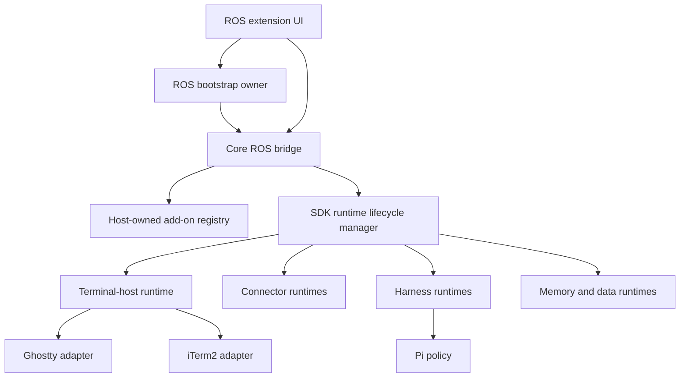

# ROS Bridge + SDK Add-on Runtime Lifecycle Roadmap

**Date:** 2026-10-06  
**Status:** Planned; terminal-host functional seam complete, SDK lifecycle integration not started  
**Owner:** Core bridge + Add-on SDK + Extension UI  
**Branch:** `r-and-d/terminal-host-current-dev`  
**Decision scope:** Browser-first ROS extension + authenticated loopback Node bridge

---

## 1. Product outcome

A user starts ResonantOS once. ROS starts and owns its authenticated local
bridge. From the ROS add-on UI, the user can install, enable, authorize, inspect,
start, stop, and diagnose modular add-on runtimes. Terminal add-ons are the
first complete implementation:

1. Start ROS.
2. ROS reports the core bridge as `Connected`.
3. Open **Bridge & Runtimes** to see active add-ons, connectors, and sessions.
4. Open **Add-on Surfaces → Terminal**.
5. Enable and authorize Ghostty or iTerm2.
6. The SDK lifecycle manager starts the selected terminal-host adapter.
7. The selected terminal tab changes to `Connected`.
8. Select Pi → **Open in Terminal**.
9. Pi opens in the selected terminal with only the ROS-granted credential,
   project, skills, and memory projection.
10. Disable the terminal add-on; ROS closes ROS-owned sessions and reports the
    runtime as `Inactive`.
11. Stop ROS; ROS stops add-on runtimes and the core bridge.

The user never runs `node run-bridge-minimal.mjs` manually.

---

## 2. Architecture decision

### 2.1 One core bridge, modular runtime services

ROS uses one authenticated core bridge process with modular SDK-managed runtime
services behind it.



The bridge owns common authentication, capability enforcement, status,
telemetry, and route composition. Runtime services start only when their
host-owned SDK state requires them.

### 2.2 Add-ons do not start the core bridge

The core bridge belongs to ROS and starts with ROS. Add-ons consume bridge
services. Enabling an add-on activates its reviewed runtime module, not the
bridge process itself.

### 2.3 Category does not determine runtime lifecycle

Per ADR-046, classification describes what an add-on is and grants no
authority. Runtime activation derives from:

- validated manifest identity;
- `runtimeType` and reviewed runtime binding;
- installed/enabled state;
- host-owned capability grants;
- compatibility verdict;
- revocation policy;
- generation/ownership state.

Do not create a bridge per category and do not branch lifecycle behavior on
`classification.category`.

### 2.4 Offline bootstrap must exist outside the bridge

A stopped bridge cannot serve a route that starts itself. The browser extension
must obtain core bridge status/start/restart through an independent ROS
bootstrap boundary:

- preferred Alpha path: installed ROS native-messaging/bootstrap host;
- acceptable development path: ROS-managed `launchd` service on macOS;
- future native-shell path: the desktop host process directly owns the bridge.

The bootstrap boundary may return public status, but never bridge capability
tokens or provider credentials.

---

## 3. Current baseline

### Complete

- Authenticated loopback bridge and capability-gated routes.
- Terminal host contract and Ghostty/iTerm2 adapters.
- Generic external CLI harness launcher and reviewed `pi-v1` policy.
- Host-owned single-use grant and authenticated terminal attach.
- Credential/project/skills/memory projection.
- Tabbed Terminal add-on surfaces with connection badges.
- `Open in Terminal` Pi affordance, capability authorization, and auto-retry.
- Terminal status and launch routes.
- Real Ghostty + real Pi smoke proof.

### Missing

- Core bridge lifecycle owned by ROS startup.
- Generic SDK add-on runtime lifecycle manager.
- Reviewed runtime factory registry.
- Registry-driven activation/deactivation/recovery.
- Generic public runtime/connector/session projection.
- **Bridge & Runtimes** UI.
- Terminal enable/disable connected to the generic lifecycle manager.
- End-to-end operator proof through the ROS UI without a manually started bridge.

### Superseded direction

The historical [Launch Bridge prompt](../../prompts/TERMINAL-HOST-LAUNCH-BRIDGE-PROMPT.md) must not be implemented as
written. Its proposed `/bridge/launch` route is hosted by the process it tries
to start. This roadmap replaces that design with an independent ROS bootstrap
boundary plus SDK-managed modular runtimes.

---

## 4. Public lifecycle model

### 4.1 Core bridge status

```ts
type RosBridgeStatus = "offline" | "starting" | "connected" | "degraded" | "restarting" | "failed";
```

Public bridge projection may include:

- status;
- public version;
- loopback endpoint;
- started-at timestamp;
- uptime;
- public failure code.

It must not include tokens, credentials, raw environment values, private file
paths, child argv, or unredacted errors.

### 4.2 Add-on runtime status

```ts
type AddOnRuntimeLifecycleStatus =
  "inactive" | "starting" | "ready" | "degraded" | "failed" | "stopping";

interface AddOnRuntimeLifecycleSnapshot {
  addonId: string;
  runtimeId: string;
  status: AddOnRuntimeLifecycleStatus;
  generation: number;
  activeSessionCount: number;
  startedAt?: string;
  lastTransitionAt?: string;
  publicFailureCode?: string;
}
```

### 4.3 Desired-state rule

```text
desiredRunning =
  installed
  AND enabled
  AND required capabilities granted
  AND compatible
  AND reviewed runtime factory exists
  AND no hard-stop revocation fence is active
```

UI state never starts a service directly. The host-owned registry projection is
the source of truth.

### 4.4 User-facing add-on states

| SDK/runtime condition              | UI label               |
| ---------------------------------- | ---------------------- |
| no installation                    | Not installed          |
| installed, disabled                | Disabled               |
| enabled, grant missing             | Authorization required |
| desired running, start in progress | Starting               |
| runtime ready                      | Connected / Ready      |
| runtime degraded                   | Degraded               |
| start or health failure            | Failed                 |
| stop in progress                   | Stopping               |
| authorized but inactive            | Disconnected           |

---

## 5. Program checkpoints

| Checkpoint | Outcome                                           | Status      |
| ---------- | ------------------------------------------------- | ----------- |
| CP-BR0     | Decision, roadmap, and supersession recorded      | Complete    |
| CP-BR1     | Independent core bridge bootstrap contract        | **Complete (r-and-d/terminal-host-current-dev)** |
| CP-BR2     | Core bridge starts/stops with ROS                 | **Complete (r-and-d/terminal-host-current-dev)** |
| CP-BR3     | Generic SDK runtime lifecycle contract + resolver | **Complete (r-and-d/terminal-host-current-dev)** |
| CP-BR4     | Runtime factory registry + reconciler             | **Complete (r-and-d/terminal-host-current-dev)** |
| CP-BR5     | Runtime/connector/session projection              | Not started |
| CP-BR6     | Bridge & Runtimes UI                              | Not started |
| CP-BR7     | Terminal add-ons use generic lifecycle            | Not started |
| CP-BR8     | UI-only end-to-end acceptance                     | Not started |
| CP-BR9     | Packaging, recovery, and documentation complete   | Not started |

Every checkpoint ends with `STOP AND REPORT`. Do not start the next checkpoint
until its code, tests, docs, and non-leak evidence are recorded.

---

## 6. Phase 0 — Decision and safety baseline · CP-BR0

### Goal

Freeze the architecture before implementation and prevent the superseded
self-start route from being built.

### Checklist

- [x] Record this roadmap in the architecture index.
- [x] Mark `TERMINAL-HOST-LAUNCH-BRIDGE-PROMPT.md` superseded.
- [x] Record one-core-bridge/modular-runtime decision in ADR-047.
- [x] Confirm the Alpha bootstrap owner: a dedicated Browser-First Chrome
      native-messaging bootstrap host.
- [x] Inventory current bridge startup paths and local LaunchAgent state.
- [x] Freeze public bridge/runtime status vocabularies.
- [x] Define secret/path fields prohibited from public projections.

### CP-BR0 reconciliation record

ADR-047 selects a dedicated Browser-First Chrome native-messaging host as the
Alpha owner. The existing `apps/augmentor` native host supplies packaging,
framing, and reconnect precedent only; it remains an independent product. No
packaged `launchd` plist or installer exists, so launchd is an optional future
macOS supervisor rather than lifecycle authority.

The implemented Alpha remains the unpacked extension plus manually started Node
bridge until CP-BR1 packages the selected owner. Generated bridge config remains
machine-local and the existing extension rebind chain refreshes on storage
changes or authenticated `401` recovery; CP-BR1 must add explicit post-start
adoption rather than relying on a stopped bridge route.

The superseded implementation is reconciled as follows:

- `bridge-launcher.mjs` and its tests are retained as deprecated implementation
  evidence for probe/env/timeout ideas, but are unreachable from production UI
  or bridge routes;
- `POST /bridge/launch` and `bridge_launch` are removed;
- Settings and Open-in-Terminal no longer render or call a self-start action;
- regression tests assert the route and UI action remain absent.

### Gate

- Architecture review agrees that add-ons activate runtime modules, not the
  bridge.
- No reachable code path asks the stopped bridge to start itself.
- Documentation names one bootstrap owner for Alpha.

### Documentation

- This roadmap.
- Bootstrap decision ADR.
- Migration note for the superseded prompt.

---

## 7. Phase 1 — Independent core bridge bootstrap · CP-BR1

### Goal

Provide a status/start/restart boundary that remains reachable while the core
bridge is offline.

### Checklist

- [x] Define bootstrap protocol: `status`, `start`, `restart`, `stopForShutdown`.
- [x] Pin the bridge entrypoint and working directory.
- [x] Use a fixed argv shape; no caller-supplied command or shell string.
- [x] Define an explicit child environment allowlist.
- [x] Ensure provider credentials and capability tokens are not supplied by UI.
- [x] Make `start` idempotent.
- [x] Bound startup and health-check timeouts.
- [x] Return public failure codes only.
- [x] Add generation/instance identity to reject stale status.
- [x] Add negative tests for arbitrary command, non-loopback endpoint, env
      widening, duplicate start, timeout, and stale generation.

### Gate

- An offline bootstrap fixture starts the reviewed bridge entrypoint once.
- A second start returns `already-running` without a second process.
- No secret-shaped or arbitrary path value appears in status or telemetry.

### Documentation

- [Bridge Bootstrap Protocol reference](BRIDGE-BOOTSTRAP-PROTOCOL.md).
- [macOS installation/uninstallation runbook](BRIDGE-BOOTSTRAP-MACOS-RUNBOOK.md).
- Troubleshooting guide for offline/start-failed/version-mismatch
  (see the runbook §4).

---

## 8. Phase 2 — Bridge owned by ROS startup · CP-BR2

### Goal

Start the core bridge automatically when ROS starts and stop it during ROS
shutdown.

### Checklist

- [x] ROS extension startup queries bootstrap status.
- [x] Offline → start → poll health → bind extension.
- [x] Connected → reuse existing process.
- [x] Version mismatch → public incompatibility state; no unsafe reuse.
- [x] Extension rebinds after generated bridge config changes.
- [x] Shutdown requests graceful bridge stop where ownership permits.
- [x] Unexpected exit surfaces `Failed` and a bounded retry action.
- [x] Prevent restart loops with bounded backoff.
- [x] Preserve existing bridge authentication and capability minting.

### Gate

- Fresh ROS start reaches `Bridge: Connected` without terminal commands.
- Restarting ROS does not create duplicate bridge processes.
- Bridge crash becomes visible and recoverable through ROS UI.

### Documentation

- [Bridge Bootstrap ROS Startup, Shutdown, And Recovery](BRIDGE-BOOTSTRAP-ROS-STARTUP.md).
- Process ownership and shutdown policy (see the doc §5).
- Recovery/backoff behavior.

---

## 9. Phase 3 — Generic SDK runtime lifecycle contract · CP-BR3

### Goal

Add a general add-on runtime lifecycle model independent of terminal identity or
add-on category.

### Checklist

- [x] Add public lifecycle status types.
- [x] Add pure `deriveDesiredRuntimeState()`.
- [x] Inputs come from validated manifest + host-owned registry projection.
- [x] Missing grant fails closed.
- [x] Missing compatibility fails closed.
- [x] Missing reviewed runtime factory fails closed.
- [x] Revocation behavior maps to stop/degrade policy.
- [x] Projection includes public identifiers only.
- [x] Add fixture add-ons for local-service, agent-addon, UI-only, and connector.
- [x] Assert category changes do not change lifecycle authority.

### Gate

- Resolver matrix covers install/enable/grant/compatibility/revocation.
- No process or I/O occurs in resolver tests.
- UI-only add-ons never request a runtime process.

### Documentation

- [SDK Add-on Runtime Lifecycle Contract (CP-BR3)](SDK-RUNTIME-LIFECYCLE-CONTRACT.md).
- Add-on author guide: when a runtime is required (see the contract doc §8).
- Runtime status vocabulary (see the contract doc §1 and §5).

---

## 10. Phase 4 — Runtime factory registry and reconciler · CP-BR4

### Goal

Start and stop reviewed add-on runtimes from registry state.

### Checklist

- [x] Add a reviewed runtime factory registry.
- [x] Never execute arbitrary `manifest.service.entrypoint` shell text.
- [x] Implement idempotent `reconcile(snapshot)`.
- [x] Serialize lifecycle transitions per add-on.
- [x] Add generation fencing.
- [x] Bound start/stop/health timeouts.
- [x] Stop stale runtime after generation replacement.
- [x] Restore desired runtimes after bridge restart.
- [x] Close runtime-owned sessions on stop.
- [x] Emit non-secret lifecycle events.
- [x] Preserve registry authority if UI state is stale or forged.

### Gate

- Fixture runtime starts once, remains idempotent, stops once, and restores after
  bridge restart.
- Failed/stale start cannot become active after a newer generation.
- Revoke/remove produces deterministic cleanup.

### Documentation

- [Runtime Factory Registry And Reconciler (CP-BR4)](RUNTIME-FACTORY-REGISTRY-AND-RECONCILER.md).
- Runtime factory registration guide (see the doc §3).
- Lifecycle manager ownership contract (see the doc §11).
- Failure/recovery semantics (see the doc §6).

---

## 11. Phase 5 — Runtime, connector, and session projection · CP-BR5

### Goal

Expose a single non-secret projection for the Bridge & Runtimes UI.

### Checklist

- [ ] Add bridge overview projection.
- [ ] Add runtime list projection.
- [ ] Add connector list projection.
- [ ] Add active-session summary.
- [ ] Include public health and failure codes.
- [ ] Include active session counts, not private session data.
- [ ] Define polling/push update mechanism.
- [ ] Shape-walker every public payload.
- [ ] Redact logs and rejection serialization.
- [ ] Add stale projection/generation behavior.

### Gate

- Projection reflects lifecycle transitions in order.
- No token, credential, prompt content, memory content, raw env, auth-file path,
  token-file path, or child argv is present.
- Unknown runtime types remain displayable through public identifiers.

### Documentation

- Bridge/runtime projection schema.
- Public failure-code catalog.
- Privacy and redaction contract.

---

## 12. Phase 6 — Bridge & Runtimes UI · CP-BR6

### Goal

Make bridge infrastructure and SDK runtime activation observable and operable
inside ROS.

### Required views

#### Overview

- Core bridge state, version, uptime, endpoint.
- Runtime, connector, and active-session counts.
- Overall health.

#### Add-on runtimes

- Add-on label and runtime type.
- Disabled/authorization/starting/ready/degraded/failed state.
- Active session count.
- Enable/disable/retry/restart actions through SDK transactions.

#### Connectors

- Connector label and public connection state.
- Authorization state.
- Last successful public health timestamp.

#### Sessions

- Public runtime/session identifiers.
- Running/idle/stopped state.
- Safe terminate action where supported.

#### Diagnostics

- Redacted lifecycle events.
- Public failure codes.
- Retry/restart controls.

### Checklist

- [ ] Add **Settings → Bridge & Runtimes** navigation.
- [ ] Offline UI comes from bootstrap status, not bridge routes.
- [ ] Online detail comes from bridge runtime projection.
- [ ] Use textContent/React text rendering only.
- [ ] Add accessible status badges and live regions.
- [ ] Add loading, empty, degraded, and failed states.
- [ ] Confirm UI actions use host transactions, never local flags.
- [ ] Add component and App integration tests.

### Gate

- Operator can distinguish core bridge health from an individual add-on runtime.
- Every action survives page reload because host state is authoritative.
- UI displays no secret or private path.

### Documentation

- User guide: Bridge & Runtimes.
- UI state glossary.
- Operator troubleshooting flow.

---

## 13. Phase 7 — Terminal add-ons on generic lifecycle · CP-BR7

### Goal

Make Ghostty/iTerm2 the first production proof of the generic lifecycle manager.

### Checklist

- [ ] Register reviewed Ghostty runtime factory.
- [ ] Register reviewed iTerm2 runtime factory.
- [ ] Wrap existing `createTerminalHostService`; do not rebuild adapters.
- [ ] Enable + grant starts selected adapter.
- [ ] Disable/revoke/remove stops adapter.
- [ ] Stop closes tracked ROS-owned sessions.
- [ ] Switching terminal stops old adapter before activating new adapter.
- [ ] Connection badges derive from generic runtime projection.
- [ ] `Open in Terminal` is enabled only when runtime is `ready`.
- [ ] Existing Pi grant/resource projection remains unchanged.
- [ ] Preserve no-confirm Ghostty teardown and zero leaked windows.

### Gate

- User activates Ghostty entirely through ROS add-on UI.
- Ghostty transitions Authorization required → Starting → Connected.
- Switching to iTerm2 transitions deterministically without duplicate ownership.
- Disable closes sessions and changes status to Disabled/Disconnected.

### Documentation

- Terminal add-on activation guide.
- Terminal switching and cleanup semantics.
- Ghostty/iTerm2 platform prerequisites.

---

## 14. Phase 8 — End-to-end acceptance · CP-BR8

### Automated checklist

- [ ] Bootstrap offline/start/already-running/restart tests.
- [ ] SDK desired-state matrix.
- [ ] Lifecycle manager start/stop/generation/recovery tests.
- [ ] Projection shape-walker and hostile-value tests.
- [ ] Bridge & Runtimes UI component tests.
- [ ] Terminal activation/deactivation integration tests.
- [ ] Full core/demo/browser-first regression.
- [ ] Stub terminal smoke.
- [ ] Real Ghostty smoke.
- [ ] iTerm2 parity smoke where available.

### Operator checklist — record Yes/No

| #   | Proof                                           | Yes/No | Evidence |
| --- | ----------------------------------------------- | ------ | -------- |
| 1   | ROS starts bridge automatically                 |        |          |
| 2   | Bridge & Runtimes shows Connected               |        |          |
| 3   | Ghostty appears under Terminal add-on surfaces  |        |          |
| 4   | Enabling Ghostty requests terminal-host grant   |        |          |
| 5   | Ghostty transitions Starting → Connected        |        |          |
| 6   | Pi shows Open in Terminal                       |        |          |
| 7   | Pi opens in Ghostty                             |        |          |
| 8   | Pi receives ROS project                         |        |          |
| 9   | Pi receives ROS skills                          |        |          |
| 10  | Pi receives ROS memory context                  |        |          |
| 11  | Pi can use approved provider credential         |        |          |
| 12  | No token/credential appears in UI/logs/argv/bus |        |          |
| 13  | Disable closes ROS-owned terminal windows       |        |          |
| 14  | Bridge/runtime UI updates after disable         |        |          |
| 15  | ROS restart restores enabled runtimes once      |        |          |

### Gate

All mandatory rows are `Yes`, regression suites are green, and evidence is
recorded without secrets.

---

## 15. Phase 9 — Packaging, recovery, and release documentation · CP-BR9

### Checklist

- [ ] Package/install bootstrap owner.
- [ ] Uninstall removes bootstrap configuration safely.
- [ ] Bridge version compatibility policy.
- [ ] Upgrade and rollback behavior.
- [ ] Crash-loop protection.
- [ ] Redacted diagnostics export.
- [ ] Release-scope audit updated.
- [ ] Security pipeline spawn/env allowlists updated.
- [ ] Module ownership and module map updated.
- [ ] Add-on SDK docs updated.
- [ ] User documentation and support runbook complete.

### Gate

Fresh-machine install, upgrade, restart, and uninstall all pass without manual
bridge commands or leaked secrets.

---

## 16. Test matrix

### Core bridge

- Offline, starting, connected, degraded, failed, restarting.
- Duplicate start and stale generation.
- Version mismatch and health timeout.
- Bootstrap unavailable.

### Runtime lifecycle

- Installed/disabled.
- Enabled/ungranted.
- Enabled/granted/incompatible.
- Enabled/granted/compatible.
- Start failure.
- Health degradation.
- Revoke, disable, remove, replacement, bridge restart.

### Runtime families

- UI-only: no process.
- Terminal local service.
- Connector local service.
- External CLI harness.
- Fixture runtime for deterministic lifecycle tests.

### Security

- Arbitrary command/argv rejection.
- Environment widening rejection.
- Non-loopback rejection.
- Capability denial.
- Token/credential/path/env/prompt/memory non-leak.
- Forged UI and stale projection rejection.

---

## 17. Documentation deliverables

| Deliverable                           | Phase |
| ------------------------------------- | ----- |
| Bridge bootstrap ADR                  | 0–1   |
| SDK runtime lifecycle contract        | 3     |
| Runtime factory author guide          | 4     |
| Runtime/connector projection schema   | 5     |
| Bridge & Runtimes user guide          | 6     |
| Terminal activation guide             | 7     |
| Operator acceptance record            | 8     |
| Packaging/upgrade/uninstall runbook   | 9     |
| Module ownership + module map updates | 9     |

Every implementation prompt produced from this roadmap must cite this file and
state which checkpoint it closes.

---

## 18. Risks and mitigations

| Risk                                 | Mitigation                                         |
| ------------------------------------ | -------------------------------------------------- |
| Bridge tries to start itself         | Independent bootstrap owner; no self-start route   |
| Arbitrary manifest process execution | Reviewed runtime factory registry                  |
| Category becomes authority           | Desired state ignores category                     |
| Duplicate/stale runtime instances    | Idempotency + generation fencing                   |
| Secret leakage in status/UI          | Public schemas + shape-walkers + redacted logs     |
| Crash/restart loop                   | Bounded backoff + explicit failed state            |
| Disable leaves terminal windows      | Existing tracked-session `stop()` cleanup          |
| UI state diverges from host          | Registry/runtime projections are authoritative     |
| Browser extension cannot spawn       | Native bootstrap or ROS-managed OS service         |
| One bridge becomes monolithic        | Modular service factories and ownership boundaries |

---

## 19. Definition of done

This program is complete when:

- ROS owns the bridge lifecycle and no manual bridge command is required;
- the bridge remains one authenticated core process with modular SDK runtimes;
- add-on runtime activation is driven solely by validated host-owned registry
  state and reviewed factories;
- Bridge & Runtimes makes bridge, runtime, connector, and session state visible;
- terminal add-ons can be enabled, authorized, switched, and disabled in ROS;
- Pi launches in Ghostty/iTerm2 with ROS-granted resources;
- all lifecycle, cleanup, recovery, and non-leak gates pass;
- operator acceptance evidence is recorded Yes/No without exposing secrets.

---

## 20. Immediate next action

Create the **CP-BR0/CP-BR1 implementation prompt**. It must:

1. mark the old Launch Bridge prompt superseded;
2. inventory and choose the Alpha bootstrap owner;
3. define the independent bootstrap protocol;
4. add deterministic tests before integrating startup into the extension.

Do not begin terminal lifecycle reconciliation until CP-BR1 and CP-BR2 are
green; otherwise the UI will still depend on a manually started bridge.
