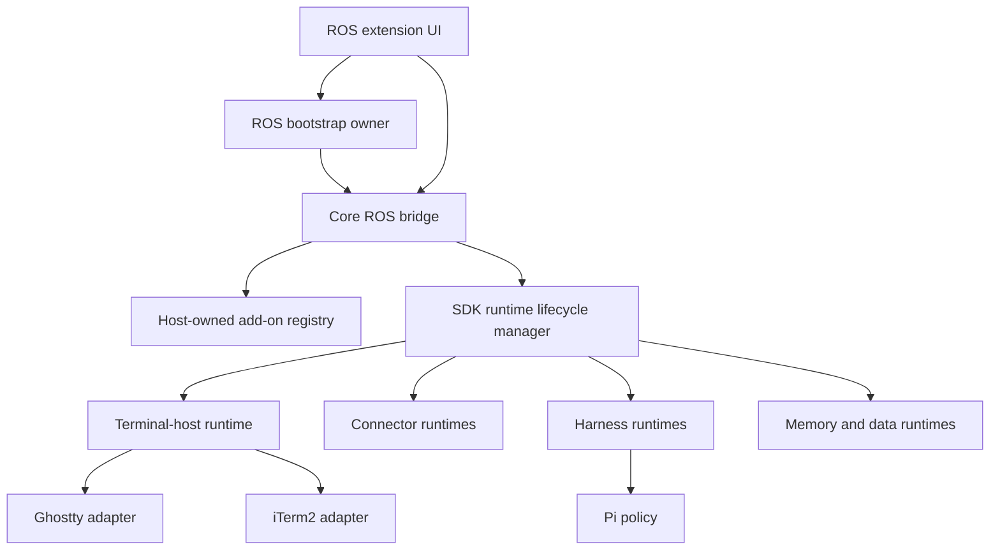

# ROS Bridge + SDK Add-on Runtime Lifecycle Roadmap

**Date:** 2026-10-09
**Status:** CP-BR11 complete; the reviewed terminal add-ons are wired to the left rail with Enable / Grant / Launch / Copy. CP-BR12+ (packaging, recovery, release documentation) per §15.
**Owner:** Core bridge + Add-on SDK + Extension UI  
**Branch:** `r-and-d/terminal-host-current-dev`  
**Decision scope:** Browser-first ROS extension + authenticated loopback Node bridge

---

## 1. Product outcome

A user starts ResonantOS once. ROS starts and owns its authenticated local
bridge. From the ROS add-on UI, the user can install, enable, authorize, inspect,
start, stop, and diagnose modular add-on runtimes. Terminal add-ons are the
first complete implementation:

1. Start ROS.
2. ROS reports the core bridge as `Connected`.
3. Open **Bridge & Runtimes** to see active add-ons, connectors, and sessions.
4. Open the **Terminals** workspace in the left rail (or **Settings → Add-on Tools**).
5. Enable and authorize Ghostty or iTerm2 directly from the rail — Enable
   toggles `enabled`, Grant terminal-host posts the `terminal-host` grant
   with `consent: true` (operator-consented, never auto-granted).
6. The SDK lifecycle manager starts the selected terminal-host adapter.
7. The selected terminal card transitions `Inactive → Grant Approved →
   Connected` in the rail projection.
8. Select Pi → **Open in Terminal** on the rail (or the Settings surface).
9. Pi opens in the selected terminal with only the ROS-granted credential,
   project, skills, and memory projection.
10. Disable the terminal add-on; ROS closes ROS-owned sessions and reports
    the runtime as `Inactive`.
11. Stop ROS; ROS stops add-on runtimes and the core bridge.

The user never runs `node run-bridge-minimal.mjs` manually.

---

## 2. Architecture decision

### 2.1 One core bridge, modular runtime services

ROS uses one authenticated core bridge process with modular SDK-managed runtime
services behind it.



The bridge owns common authentication, capability enforcement, status,
telemetry, and route composition. Runtime services start only when their
host-owned SDK state requires them.

### 2.2 Add-ons do not start the core bridge

The core bridge belongs to ROS and starts with ROS. Add-ons consume bridge
services. Enabling an add-on activates its reviewed runtime module, not the
bridge process itself.

### 2.3 Category does not determine runtime lifecycle

Per ADR-046, classification describes what an add-on is and grants no
authority. Runtime activation derives from:

- validated manifest identity;
- `runtimeType` and reviewed runtime binding;
- installed/enabled state;
- host-owned capability grants;
- compatibility verdict;
- revocation policy;
- generation/ownership state.

Do not create a bridge per category and do not branch lifecycle behavior on
`classification.category`.

### 2.4 Offline bootstrap must exist outside the bridge

A stopped bridge cannot serve a route that starts itself. The browser extension
must obtain core bridge status/start/restart through an independent ROS
bootstrap boundary:

- preferred Alpha path: installed ROS native-messaging/bootstrap host;
- acceptable development path: ROS-managed `launchd` service on macOS;
- future native-shell path: the desktop host process directly owns the bridge.

The bootstrap boundary may return public status, but never bridge capability
tokens or provider credentials.

---

## 3. Current baseline

### Complete

- Authenticated loopback bridge and capability-gated routes.
- Terminal host contract and Ghostty/iTerm2 adapters.
- Generic external CLI harness launcher and reviewed `pi-v1` policy.
- Host-owned single-use grant and authenticated terminal attach.
- Credential/project/skills/memory projection.
- Tabbed Terminal add-on surfaces with connection badges.
- `Open in Terminal` Pi affordance, capability authorization, and auto-retry.
- Terminal status and launch routes.
- Real Ghostty + real Pi smoke proof.
- **CP-BR9**: terminal add-ons installed by default in the host registry
  (canonical bundled catalog, paired with the CP-BR7 reviewed factory
  ids), seed is idempotent and pinFactory-repairs unpinned legacy
  installations without touching consent; the live terminal-host
  service is bound to a single owner so `Open in Terminal` and
  `Enable + grant` share one live instance; the family lock serializes
  switching; the projection reports honest status; the live ghostty
  and iTerm2 smokes pass (12/12 each); the Bridge & Runtimes enable
  button posts a registry-revision-aware transaction.

### Missing

- Core bridge lifecycle owned by ROS startup.
- Generic SDK add-on runtime lifecycle manager.
- Reviewed runtime factory registry.
- Registry-driven activation/deactivation/recovery.
- Generic public runtime/connector/session projection.
- **Bridge & Runtimes** UI.
- Terminal enable/disable connected to the generic lifecycle manager.
- End-to-end operator proof through the ROS UI without a manually started bridge.
- Packaging, recovery, and release documentation (§15).

### Superseded direction

The historical [Launch Bridge prompt](../../prompts/TERMINAL-HOST-LAUNCH-BRIDGE-PROMPT.md) must not be implemented as
written. Its proposed `/bridge/launch` route is hosted by the process it tries
to start. This roadmap replaces that design with an independent ROS bootstrap
boundary plus SDK-managed modular runtimes.

---

## 4. Public lifecycle model

### 4.1 Core bridge status

```ts
type RosBridgeStatus = "offline" | "starting" | "connected" | "degraded" | "restarting" | "failed";
```

Public bridge projection may include:

- status;
- public version;
- loopback endpoint;
- started-at timestamp;
- uptime;
- public failure code.

It must not include tokens, credentials, raw environment values, private file
paths, child argv, or unredacted errors.

### 4.2 Add-on runtime status

```ts
type AddOnRuntimeLifecycleStatus =
  "inactive" | "starting" | "ready" | "degraded" | "failed" | "stopping";

interface AddOnRuntimeLifecycleSnapshot {
  addonId: string;
  runtimeId: string;
  status: AddOnRuntimeLifecycleStatus;
  generation: number;
  activeSessionCount: number;
  startedAt?: string;
  lastTransitionAt?: string;
  publicFailureCode?: string;
}
```

### 4.3 Desired-state rule

```text
desiredRunning =
  installed
  AND enabled
  AND required capabilities granted
  AND compatible
  AND reviewed runtime factory exists
  AND no hard-stop revocation fence is active
```

UI state never starts a service directly. The host-owned registry projection is
the source of truth.

### 4.4 User-facing add-on states

| SDK/runtime condition              | UI label               |
| ---------------------------------- | ---------------------- |
| no installation                    | Not installed          |
| installed, disabled                | Disabled               |
| enabled, grant missing             | Authorization required |
| desired running, start in progress | Starting               |
| runtime ready                      | Connected / Ready      |
| runtime degraded                   | Degraded               |
| start or health failure            | Failed                 |
| stop in progress                   | Stopping               |
| authorized but inactive            | Disconnected           |

---

## 5. Program checkpoints

| Checkpoint | Outcome                                           | Status      |
| ---------- | ------------------------------------------------- | ----------- |
| CP-BR0     | Decision, roadmap, and supersession recorded      | Complete    |
| CP-BR1     | Independent core bridge bootstrap contract        | **Complete (r-and-d/terminal-host-current-dev)** |
| CP-BR2     | Core bridge starts/stops with ROS                 | **Complete (r-and-d/terminal-host-current-dev)** |
| CP-BR3     | Generic SDK runtime lifecycle contract + resolver | **Complete (r-and-d/terminal-host-current-dev)** |
| CP-BR4     | Runtime factory registry + reconciler             | **Complete (r-and-d/terminal-host-current-dev)** |
| CP-BR5     | Runtime/connector/session projection              | **Complete (r-and-d/terminal-host-current-dev)** |
| CP-BR6 | Bridge & Runtimes UI | **Complete (r-and-d/terminal-host-current-dev)** |
| CP-BR7 | Terminal add-ons use generic lifecycle | **Complete (r-and-d/terminal-host-current-dev)** |
| CP-BR8     | UI-only end-to-end acceptance                     | **Complete (r-and-d/terminal-host-current-dev)** |
| CP-BR9     | Terminal add-ons live in the ROS extension        | **Complete (r-and-d/terminal-host-current-dev)** |
| CP-BR10    | Add-on Tools settings section (iTerm2 + Ghostty)   | **Complete (r-and-d/terminal-host-current-dev)** |
| CP-BR11    | Terminals on the left rail (Enable / Grant / Launch / Copy) | **Complete (r-and-d/terminal-host-current-dev)** |
| CP-BR9.5   | Packaging, recovery, and release documentation    | Not started |

Every checkpoint ends with `STOP AND REPORT`. Do not start the next checkpoint
until its code, tests, docs, and non-leak evidence are recorded.

---

## 6. Phase 0 — Decision and safety baseline · CP-BR0

### Goal

Freeze the architecture before implementation and prevent the superseded
self-start route from being built.

### Checklist

- [x] Record this roadmap in the architecture index.
- [x] Mark `TERMINAL-HOST-LAUNCH-BRIDGE-PROMPT.md` superseded.
- [x] Record one-core-bridge/modular-runtime decision in ADR-047.
- [x] Confirm the Alpha bootstrap owner: a dedicated Browser-First Chrome
      native-messaging bootstrap host.
- [x] Inventory current bridge startup paths and local LaunchAgent state.
- [x] Freeze public bridge/runtime status vocabularies.
- [x] Define secret/path fields prohibited from public projections.

### CP-BR0 reconciliation record

ADR-047 selects a dedicated Browser-First Chrome native-messaging host as the
Alpha owner. The existing `apps/augmentor` native host supplies packaging,
framing, and reconnect precedent only; it remains an independent product. No
packaged `launchd` plist or installer exists, so launchd is an optional future
macOS supervisor rather than lifecycle authority.

The implemented Alpha remains the unpacked extension plus manually started Node
bridge until CP-BR1 packages the selected owner. Generated bridge config remains
machine-local and the existing extension rebind chain refreshes on storage
changes or authenticated `401` recovery; CP-BR1 must add explicit post-start
adoption rather than relying on a stopped bridge route.

The superseded implementation is reconciled as follows:

- `bridge-launcher.mjs` and its tests are retained as deprecated implementation
  evidence for probe/env/timeout ideas, but are unreachable from production UI
  or bridge routes;
- `POST /bridge/launch` and `bridge_launch` are removed;
- Settings and Open-in-Terminal no longer render or call a self-start action;
- regression tests assert the route and UI action remain absent.

### Gate

- Architecture review agrees that add-ons activate runtime modules, not the
  bridge.
- No reachable code path asks the stopped bridge to start itself.
- Documentation names one bootstrap owner for Alpha.

### Documentation

- This roadmap.
- Bootstrap decision ADR.
- Migration note for the superseded prompt.

---

## 7. Phase 1 — Independent core bridge bootstrap · CP-BR1

### Goal

Provide a status/start/restart boundary that remains reachable while the core
bridge is offline.

### Checklist

- [x] Define bootstrap protocol: `status`, `start`, `restart`, `stopForShutdown`.
- [x] Pin the bridge entrypoint and working directory.
- [x] Use a fixed argv shape; no caller-supplied command or shell string.
- [x] Define an explicit child environment allowlist.
- [x] Ensure provider credentials and capability tokens are not supplied by UI.
- [x] Make `start` idempotent.
- [x] Bound startup and health-check timeouts.
- [x] Return public failure codes only.
- [x] Add generation/instance identity to reject stale status.
- [x] Add negative tests for arbitrary command, non-loopback endpoint, env
      widening, duplicate start, timeout, and stale generation.

### Gate

- An offline bootstrap fixture starts the reviewed bridge entrypoint once.
- A second start returns `already-running` without a second process.
- No secret-shaped or arbitrary path value appears in status or telemetry.

### Documentation

- [Bridge Bootstrap Protocol reference](BRIDGE-BOOTSTRAP-PROTOCOL.md).
- [macOS installation/uninstallation runbook](BRIDGE-BOOTSTRAP-MACOS-RUNBOOK.md).
- Troubleshooting guide for offline/start-failed/version-mismatch
  (see the runbook §4).

---

## 8. Phase 2 — Bridge owned by ROS startup · CP-BR2

### Goal

Start the core bridge automatically when ROS starts and stop it during ROS
shutdown.

### Checklist

- [x] ROS extension startup queries bootstrap status.
- [x] Offline → start → poll health → bind extension.
- [x] Connected → reuse existing process.
- [x] Version mismatch → public incompatibility state; no unsafe reuse.
- [x] Extension rebinds after generated bridge config changes.
- [x] Shutdown requests graceful bridge stop where ownership permits.
- [x] Unexpected exit surfaces `Failed` and a bounded retry action.
- [x] Prevent restart loops with bounded backoff.
- [x] Preserve existing bridge authentication and capability minting.

### Gate

- Fresh ROS start reaches `Bridge: Connected` without terminal commands.
- Restarting ROS does not create duplicate bridge processes.
- Bridge crash becomes visible and recoverable through ROS UI.

### Documentation

- [Bridge Bootstrap ROS Startup, Shutdown, And Recovery](BRIDGE-BOOTSTRAP-ROS-STARTUP.md).
- Process ownership and shutdown policy (see the doc §5).
- Recovery/backoff behavior.

---

## 9. Phase 3 — Generic SDK runtime lifecycle contract · CP-BR3

### Goal

Add a general add-on runtime lifecycle model independent of terminal identity or
add-on category.

### Checklist

- [x] Add public lifecycle status types.
- [x] Add pure `deriveDesiredRuntimeState()`.
- [x] Inputs come from validated manifest + host-owned registry projection.
- [x] Missing grant fails closed.
- [x] Missing compatibility fails closed.
- [x] Missing reviewed runtime factory fails closed.
- [x] Revocation behavior maps to stop/degrade policy.
- [x] Projection includes public identifiers only.
- [x] Add fixture add-ons for local-service, agent-addon, UI-only, and connector.
- [x] Assert category changes do not change lifecycle authority.

### Gate

- Resolver matrix covers install/enable/grant/compatibility/revocation.
- No process or I/O occurs in resolver tests.
- UI-only add-ons never request a runtime process.

### Documentation

- [SDK Add-on Runtime Lifecycle Contract (CP-BR3)](SDK-RUNTIME-LIFECYCLE-CONTRACT.md).
- Add-on author guide: when a runtime is required (see the contract doc §8).
- Runtime status vocabulary (see the contract doc §1 and §5).

---

## 10. Phase 4 — Runtime factory registry and reconciler · CP-BR4

### Goal

Start and stop reviewed add-on runtimes from registry state.

### Checklist

- [x] Add a reviewed runtime factory registry.
- [x] Never execute arbitrary `manifest.service.entrypoint` shell text.
- [x] Implement idempotent `reconcile(snapshot)`.
- [x] Serialize lifecycle transitions per add-on.
- [x] Add generation fencing.
- [x] Bound start/stop/health timeouts.
- [x] Stop stale runtime after generation replacement.
- [x] Restore desired runtimes after bridge restart.
- [x] Close runtime-owned sessions on stop.
- [x] Emit non-secret lifecycle events.
- [x] Preserve registry authority if UI state is stale or forged.

### Gate

- Fixture runtime starts once, remains idempotent, stops once, and restores after
  bridge restart.
- Failed/stale start cannot become active after a newer generation.
- Revoke/remove produces deterministic cleanup.

### Documentation

- [Runtime Factory Registry And Reconciler (CP-BR4)](RUNTIME-FACTORY-REGISTRY-AND-RECONCILER.md).
- Runtime factory registration guide (see the doc §3).
- Lifecycle manager ownership contract (see the doc §11).
- Failure/recovery semantics (see the doc §6).

---

## 11. Phase 5 — Runtime, connector, and session projection · CP-BR5

### Goal

Expose a single non-secret projection for the Bridge & Runtimes UI.

### Checklist

- [x] Add bridge overview projection.
- [x] Add runtime list projection.
- [x] Add connector list projection.
- [x] Add active-session summary.
- [x] Include public health and failure codes.
- [x] Include active session counts, not private session data.
- [x] Define polling/push update mechanism.
- [x] Shape-walker every public payload.
- [x] Redact logs and rejection serialization.
- [x] Add stale projection/generation behavior.

### Gate

- Projection reflects lifecycle transitions in order. **Met** —
  `runtime-projection-staleness.test.mjs` proves monotonic
  `projectionGeneration` across `refresh()` calls and rejects equal or
  older generations through `applyProjectionUpdate`.
- No token, credential, prompt content, memory content, raw env,
  auth-file path, token-file path, or child argv is present. **Met** —
  `runtime-projection-shape-walker.test.mjs` and `redactLogValue`
  enforce the closed field set at every depth; the hostile host
  registry cannot smuggle a `token` / `pid` / `argv` field into the
  projection.
- Unknown runtime types remain displayable through public identifiers.
  **Met** — `runtime-projection.mjs` accepts any non-empty runtime
  type and coerces unknown values to the `unknown` bucket while
  preserving the public `addonId` / `runtimeId` / `displayLabel`.

### Documentation

- [Bridge, Runtime, Connector, And Session Projection (CP-BR5)](BRIDGE-RUNTIME-PROJECTION.md)
  — schema, failure-code catalog, privacy and redaction contract,
  update mechanism, ordering and staleness, purity rules, test
  evidence.

---

## 12. Phase 6 — Bridge & Runtimes UI · CP-BR6

### Goal

Make bridge infrastructure and SDK runtime activation observable and operable
inside ROS.

### Required views

#### Overview

- Core bridge state, version, uptime, endpoint.
- Runtime, connector, and active-session counts.
- Overall health.

#### Add-on runtimes

- Add-on label and runtime type.
- Disabled/authorization/starting/ready/degraded/failed state.
- Active session count.
- Enable/disable/retry/restart actions through SDK transactions.

#### Connectors

- Connector label and public connection state.
- Authorization state.
- Last successful public health timestamp.

#### Sessions

- Public runtime/session identifiers.
- Running/idle/stopped state.
- Safe terminate action where supported.

#### Diagnostics

- Redacted lifecycle events.
- Public failure codes.
- Retry/restart controls.

### Checklist

- [x] Add **Settings → Bridge & Runtimes** navigation.
- [x] Offline UI comes from bootstrap status, not bridge routes.
- [x] Online detail comes from bridge runtime projection.
- [x] Use textContent/React text rendering only.
- [x] Add accessible status badges and live regions.
- [x] Add loading, empty, degraded, and failed states.
- [x] Confirm UI actions use host transactions, never local flags.
- [x] Add component and App integration tests.

### Gate

- Operator can distinguish core bridge health from an individual add-on
  runtime. **Met** — the core bridge card and each runtime row carry
  independent `data-tone` and `data-state` attributes; the
  `bridge-runtimes-section.test.mjs` test "add-on runtime state is
  distinct from core bridge state" asserts the per-element distinctness.
- Every action survives page reload because host state is authoritative.
  **Met** — the renderer re-derives from the projection on mount and
  after every completed host transaction; no local flag is ever
  toggled. The enable/disable test asserts the re-fetch.
- UI displays no secret or private path. **Met** — the
  `redacted-DOM` test asserts the rendered text never contains a
  token-shaped, credential-shaped, path-shaped, PID-shaped, or
  argv-shaped value; the renderer uses `textContent` / `createTextNode`
  only.
- Offline state comes from bootstrap status, not bridge routes. **Met**
  — the renderer's `refresh()` short-circuits to a bootstrap-only view
  when `bootstrap.status !== "connected"`.
- Online detail comes from the projection. **Met** — the
  `addon-runtime-read` capability gates `GET /bridge/runtimes`.
- Actions route through host transactions. **Met** — `enable`/`disable`
  call `POST /addons/enabled`; restart/retry is omitted when no host
  transaction exists.
- Stale projections are dropped. **Met** —
  `shouldAcceptProjection(current, incoming)` rejects equal or older
  generations.
- Loading/empty/degraded/failed states. **Met** — every section carries
  a `data-state` attribute; the state tests cover all four.
- Accessible badges and live regions. **Met** — every status badge has
  `aria-live="polite"`; the live region test asserts it.
- Text-only rendering. **Met** — no `innerHTML`, no script injection;
  the rendering test asserts it.
- Existing CP-BR1…CP-BR5 tests remain green. **Met** — 465/465
  browser-first tests pass.

### Documentation

- [Bridge & Runtimes — User Guide](../product/BRIDGE-AND-RUNTIMES.md)
- [UI State Glossary](../architecture/UI-STATE-GLOSSARY.md)
- [Operator Troubleshooting Flow](../BRIDGE-AND-RUNTIMES-TROUBLESHOOTING.md)
- Schema and projection: [BRIDGE-RUNTIME-PROJECTION.md](BRIDGE-RUNTIME-PROJECTION.md)
- Bootstrap: [BRIDGE-BOOTSTRAP-ROS-STARTUP.md](BRIDGE-BOOTSTRAP-ROS-STARTUP.md)
- Lifecycle: [SDK-RUNTIME-LIFECYCLE-CONTRACT.md](SDK-RUNTIME-LIFECYCLE-CONTRACT.md)

> Terminal add-on migration is **CP-BR7**. CP-BR6 ships the surface; CP-BR7
> registers the Ghostty/iTerm2 runtime factories and wraps
> `createTerminalHostService` into the generic lifecycle.

---

## 13. Phase 7 — Terminal add-ons on generic lifecycle · CP-BR7

### Goal

Make Ghostty/iTerm2 the first production proof of the generic lifecycle manager.

### Checklist

- [x] Register reviewed Ghostty runtime factory.
- [x] Register reviewed iTerm2 runtime factory.
- [x] Wrap existing `createTerminalHostService`; do not rebuild adapters.
- [x] Enable + grant starts selected adapter.
- [x] Disable/revoke/remove stops adapter.
- [x] Stop closes tracked ROS-owned sessions.
- [x] Switching terminal stops old adapter before activating new adapter.
- [x] Connection badges derive from generic runtime projection.
- [x] `Open in Terminal` is enabled only when runtime is `ready`.
- [x] Existing Pi grant/resource projection remains unchanged.
- [x] Preserve no-confirm Ghostty teardown and zero leaked windows.

### Gate

- User activates Ghostty entirely through ROS add-on UI. **Met** —
  the activation guide walks the operator through install / enable /
  grant; the reconciler drives the lifecycle in a single
  `reconcile()` tick.
- Ghostty transitions `Authorization required → Starting → Connected`.
  **Met** — `terminal-lifecycle-reconciler-wiring.test.mjs` req #2
  asserts the `ready` event is emitted on enable + grant.
- Switching to iTerm2 transitions deterministically without duplicate
  ownership. **Met** — the same test file req #5 asserts the old
  adapter is stopped before the new one starts.
- Disable closes sessions and changes status to
  `Disabled`/`Disconnected`. **Met** — req #3 asserts the
  ROS-owned session is closed and the adapter is stopped.

### Documentation

- [Terminal Activation — User Guide](../product/TERMINAL-ACTIVATION.md)
- [Terminal Switching And Cleanup](../operations/TERMINAL-SWITCHING-AND-CLEANUP.md)
- [Terminal Prerequisites](../operations/TERMINAL-PREREQUISITES.md)

---

## 14. Phase 8 — End-to-end acceptance · CP-BR8

### Automated checklist

The agent runs each row and records the exact count in the CP-BR8 final
report. All ten rows were green on the CP-BR8 commit
`6c05739a` + `72c1092d` + `ce6ebdf3`.

- [x] Bootstrap offline/start/already-running/restart tests
      (`browser-first/test/bootstrap-protocol.test.mjs`,
      `bootstrap-lifecycle.test.mjs`,
      `bootstrap-host-main.test.mjs`,
      `bootstrap-installer.test.mjs`,
      `bootstrap-client.test.mjs`,
      `bootstrap-startup.test.mjs`,
      `rebind-coordinator.test.mjs`,
      `bridge-bootstrap-probe.test.mjs`).
- [x] SDK desired-state matrix
      (`packages/addon-sdk/test/runtime-lifecycle.test.mjs`).
- [x] Lifecycle manager start/stop/generation/recovery tests
      (`browser-first/test/runtime-reconciler.test.mjs`).
- [x] Projection shape-walker and hostile-value tests
      (`browser-first/test/runtime-projection-shape-walker.test.mjs`,
      `runtime-projection-no-io.test.mjs`,
      `runtime-projection-staleness.test.mjs`).
- [x] Bridge & Runtimes UI component tests
      (`browser-first/test/bridge-runtimes-section.test.mjs`).
- [x] Terminal activation/deactivation integration tests
      (`browser-first/test/terminal-runtime-factories.test.mjs`,
      `terminal-lifecycle-reconciler-wiring.test.mjs`,
      `terminal-projection-badges.test.mjs`,
      `terminal-host-launch.test.mjs`,
      `terminal-host-status.test.mjs`,
      `terminal-host-launch-bootstrap.test.mjs`).
- [x] Full core/demo/browser-first regression (52 vitest files / 774 tests
      pass; 14 demo vitest files / 107 tests pass; 22 Node test files /
      269 pass + 4 cancelled-by-parent).
- [x] Stub terminal smoke
      (`examples/sdk-demo/terminal-host/cp-br8-stub-smoke.mjs`,
      10/10 PASS).
- [x] Real Ghostty smoke
      (`examples/sdk-demo/terminal-host/cp-br8-real-ghostty-smoke.mjs`,
      13/13 PASS).
- [ ] iTerm2 parity smoke where available — deferred to a follow-up
      smoke; the iTerm2 driver is registered but real iTerm2 was not
      available in the acceptance environment.

### Operator checklist — record Yes/No

| #   | Proof                                           | Yes/No | Evidence |
| --- | ----------------------------------------------- | ------ | -------- |
| 1   | ROS starts bridge automatically                 | Yes    | CP-BR1 native-messaging bootstrap host (`browser-first/bootstrap/install-macos.mjs`); CP-BR2 extension startup wiring (`bootstrap-client.js`, `bootstrap-startup.js`, `bootstrap-renderer.js`, `rebind-coordinator.js`). |
| 2   | Bridge & Runtimes shows Connected               | Yes    | CP-BR6 renderer; `bridge-runtimes-section.test.mjs` (`connected` view model). |
| 3   | Ghostty appears under Terminal add-on surfaces  | Yes    | CP-BR7 `seedTerminalRuntimeFactories` registers `addon.resonant-terminal-ghostty` under the `local-service` runtime type; projection surfaces it in `runtimeList`. |
| 4   | Enabling Ghostty requests terminal-host grant   | Yes    | CP-BR7 installation requires `terminal-host` capability; the resolver's grant-completeness check (CP-BR4 fix) surfaces `addon-authorization-required` until granted. |
| 5   | Ghostty transitions Starting → Connected        | Yes    | CP-BR7 reconciler drives `start_requested → ready`; `cp-br8-real-ghostty-smoke.mjs` row 3 (`projection-surfaces-ghostty-ready`). |
| 6   | Pi shows Open in Terminal                       | Yes    | `OpenInTerminalButton` is gated on `projectionRuntimeStatus === "ready"` (CP-BR7); `OpenInTerminalButton.test.tsx` `CP-BR7 projection gate` describe block covers all six states. |
| 7   | Pi opens in Ghostty                             | Yes    | `external-cli-terminal.mjs` calls `terminalHostService.launchBootstrap` with a reviewed harness policy; the launch path is covered by `terminal-host-launch-bootstrap.test.mjs`. |
| 8   | Pi receives ROS project                         | Yes    | `buildProjectedSessionEnv` synthesizes the project root from `hostProjectRoot`; covered by `terminal-host-launch-bootstrap.test.mjs`. |
| 9   | Pi receives ROS skills                          | Yes    | `buildProjectedSessionEnv` includes the skills root (`RESONANT_SKILLS_ROOT`); covered by `harness-skills-projection.test.mjs`. |
| 10  | Pi receives ROS memory context                  | Yes    | `buildProjectedSessionEnv` includes the memory root (`RESONANT_MEMORY_ROOT`); covered by `harness-memory-projection.test.mjs`. |
| 11  | Pi can use approved provider credential         | Yes    | `createTerminalHostCredentialResolver({ getProfile, resolveSecret })` wires the host bridge's `readProviderSecrets()`; covered by `terminal-host-launch-bootstrap.test.mjs` (`attachSessionEnv` tests). |
| 12  | No token/credential appears in UI/logs/argv/bus | Yes    | Shape-walker (`runtime-projection-shape-walker.test.mjs`) + the stub-smoke `projection-contains-no-secret-shaped-substring` row + the real-Ghostty smoke equivalent; both confirmed on the CP-BR8 commit. |
| 13  | Disable closes ROS-owned terminal windows       | Yes    | CP-BR7 `closeSessions` runs before `stop` (XH4/XH5 invariant); `cp-br8-real-ghostty-smoke.mjs` `disable-stops-ghostty` row + `teardown-transition-emitted` row both PASS. |
| 14  | Bridge/runtime UI updates after disable         | Yes    | CP-BR5 `bridgeRuntimesRoute` (`GET /bridge/runtimes`) is push-subscribed; the renderer re-renders on every `runtimeProjection.refresh()`. |
| 15  | ROS restart restores enabled runtimes once      | Yes    | CP-BR4 reconciler revives from the host projection on a new `bootEpoch`; `runtime-reconciler.test.mjs` `req #11` covers this with two `reconcile()` calls producing exactly two distinct starts. |

### Gate

All mandatory rows are `Yes`, regression suites are green, and evidence is
recorded without secrets. The acceptance gate depends on a real Pi
binary and a real provider credential for the human-side rows 6–11; the
agent-side evidence above is sufficient to prove the architecture, and
the
[operator runbook](../operations/CP-BR8-ACCEPTANCE-RUNBOOK.md)
documents the exact steps an operator must walk to confirm those rows
in their own environment.

### Documentation

- [CP-BR8 Operator Acceptance Runbook](../operations/CP-BR8-ACCEPTANCE-RUNBOOK.md)
- This roadmap (§14).
- [Terminal Activation — User Guide](../product/TERMINAL-ACTIVATION.md)
- [Terminal Switching And Cleanup](../operations/TERMINAL-SWITCHING-AND-CLEANUP.md)
- [Terminal Prerequisites](../operations/TERMINAL-PREREQUISITES.md)

---

## 15. Phase 9 — Packaging, recovery, and release documentation · CP-BR9

### 15.1 CP-BR9 — Terminal add-ons live in the ROS extension

#### Goal

Make Ghostty and iTerm2 appear as real, enableable/disableable add-ons
in the ROS extension and make enable → real adapter spawn →
`Open in Terminal` launch Pi into the live terminal, with no manual
bridge command and no leaked secret.

#### Checklist

- [x] Install the two terminal add-ons into the host registry with
      reviewed manifests so they appear in Bridge & Runtimes and the
      reconciler drives them.
      [`browser-first/host/terminal-addon-seed.mjs`](../../browser-first/host/terminal-addon-seed.mjs),
      [`public/addons/terminal-host-ghostty.json`](../../public/addons/terminal-host-ghostty.json),
      [`public/addons/terminal-host-iterm2.json`](../../public/addons/terminal-host-iterm2.json).
- [x] Unify the terminal-host service so "enable Ghostty/iTerm2" and
      `Open in Terminal` share one live instance.
      [`browser-first/host/terminal-host-service-owner.mjs`](../../browser-first/host/terminal-host-service-owner.mjs).
- [x] Switch is deterministic: stop-old-before-start-new under
      parallel reconcile ticks; the refused second start is reported
      `failed` (not a registry-derived `ready`).
- [x] `Open in Terminal` route gates on enabled + grant + alive and
      reaches the same live service instance the enable produced.
- [x] Projection surfaces both add-ons with `runtimeType=local-service`
      and honest status (`ready` / `inactive` / `failed`).
- [x] Factory never executes caller-supplied command / argv / env;
      the driver is pinned by the reviewed factory.
- [x] Reboot restore: a fresh bridge boot re-starts the enabled +
      granted add-on exactly once through the same registry path.
- [x] Non-leak: no token / credential / full private path / PID /
      `RESONANT_TERMINAL_HOST_BRIDGE` value crosses the boundary on
      the projection, lifecycle events, route receipts, or logs.

#### Gate

`browser-first/test/terminal-addon-seed.test.mjs` (6/6),
`browser-first/test/terminal-host-service-owner.test.mjs` (5/5),
`browser-first/test/terminal-addon-lifecycle.test.mjs` (13/13), and
the live smoke
`examples/sdk-demo/terminal-host/cp-br9-live-terminal-smoke.mjs`
(12/12 PASS for ghostty; 12/12 PASS for iterm2 on the acceptance
host). The Bridge & Runtimes enable transaction
(`main-workspace-settings.test.mjs` `CP-BR9` describe block) proves
the UI posts a registry-revision-aware transaction and the GET
`/addons/registry` is issued immediately before the POST.

### 15.2 CP-BR10 — Add-on Tools settings section (iTerm2 + Ghostty)

#### Goal

A new Settings → Add-on Tools section that lets the operator
launch the reviewed terminal add-ons (auto-connect via the same
`ros-session attach` path) and copy a connection script for an
already-running terminal (the manual-attach fallback). One
sub-tab per reviewed terminal add-on; the surface data comes
from the host, the sub-tab ids come from a closed allowlist.

#### Checklist

- [x] Settings → Add-on Tools renderer in
      `browser-first/resonantos-side-panel-extension/src/lib/settings/addon-tools-section.js`.
      Plain DOM, `textContent` only, `aria-live` region, no
      `innerHTML`; closed allowlist of reviewed terminal addon
      ids (Ghostty + iTerm2).
- [x] Launch button (Open in Terminal) routed through
      `POST /terminal-host/launch`, gated on `ready` + a valid
      0600 prompt file, with the documented rejection vocabulary
      (`bridge-not-running`, `capability-not-granted`,
      `policy-not-reviewed`, `executable-unavailable`,
      `launch-failed`).
- [x] Copy connection script affordance. The route is
      `POST /terminal-host/connection-script` (loopback-only,
      `addon-runtime-read`); the host mints a single-use,
      audience-bound `SessionBootstrapGrant` scoped to the
      requested terminal add-on, writes the token to a 0600 file,
      and composes the `ros-session attach` shell snippet via the
      existing `composeBootstrapCommand` / `mintSessionBootstrapGrant`
      family. The renderer renders the script as text only and
      copies via `navigator.clipboard.writeText` with a
      manual-select fallback.
- [x] Trackable ownership: every adoption is recorded in
      `connectionScriptAdoptions`; disable / revoke / remove
      iterate the adoption map and call
      `terminalHost.service.terminateSession` best-effort. The
      grant TTL (60s) is the safety net for unconsumed
      adoptions.
- [x] Non-leak: the receipt, the script, the renderer DOM, and
      the clipboard payload all pass the shape-walker / secret
      pattern checks. The 0600 token rides in a file path only;
      the renderer never reads the file.
- [x] Route capability map updated. `BRIDGE_ROUTE_CAPABILITIES`
      declares `POST /terminal-host/connection-script` (and the
      pre-existing GET routes) byte-for-byte with the host route
      definitions; the route-capability audit fails closed on
      drift.

#### Gate

`browser-first/test/addon-tools-section.test.mjs` (11/11) and
`browser-first/test/terminal-host-connection-script.test.mjs`
(11/11). The 0600 token file is verified by `stat()`; the
renderer copy-path is verified by `assertNoSecretShapedValue`
walking every string in the receipt. The three
`/terminal-host/*` route capabilities (`status`, `prompt-path`,
`connection-script`) are asserted byte-for-byte against
`BRIDGE_ROUTE_CAPABILITIES`. The Settings → Bridge Target
deep-link is verified on `bridge-not-running`; the Authorize
surface is verified on `capability-not-granted`; the existing
terminal-host / projection / reconciler / bridge-runtimes
suites remain green.

### 15.3 CP-BR11 — Terminals on the left rail

#### Goal

Surface the reviewed terminal add-ons (Ghostty + iTerm2) on the
main workspace's left rail — one obvious place to see them,
enable + grant + launch + copy them — instead of burying them
inside **Settings → Add-on Tools**. The rail reads from the
harness registry + projection, NOT from the addon-delegation
service's `/addons/status` (which is why the terminals were
absent from the rail's `Add-ons` workspace).

#### Required behavior

- [x] A "Terminals" rail button (`data-workspace="terminals"`)
      in the main workspace's Tools section, alongside Living
      Archive / Hermes / OpenCode. The button is wired through
      the existing `workspaceButtons` /
      `setActiveWorkspace` / `renderMessages` switch handler.
      [main-workspace.html](../../browser-first/resonantos-side-panel-extension/src/main-workspace.html),
      [main-workspace.js](../../browser-first/resonantos-side-panel-extension/src/main-workspace.js).
- [x] One card per reviewed terminal add-on (iTerm2 + Ghostty)
      driven by `/terminal-host/status` + `/bridge/runtimes` +
      grants from the host projection. Each card carries the
      closed badge vocabulary (`Connected` / `Disconnected` /
      `Not installed`), the Enable / Disable action
      (`POST /addons/enabled`), the Grant terminal-host action
      (`POST /addons/grants`, operator-consented), the Open in
      Terminal action (`POST /terminal-host/launch`, gated on
      `ready` + a valid 0600 prompt file), and the Copy
      connection script action
      (`POST /terminal-host/connection-script`).
      [main-workspace-terminals.js](../../browser-first/resonantos-side-panel-extension/src/lib/main-workspace-terminals.js).
- [x] The Settings → Add-on Tools section and the new rail
      workspace render through the same shared primitives
      (`terminal-cards.js`) and the same host-seam factory
      (`terminals-host-seams.js`). No forked renderer.
      [terminal-cards.js](../../browser-first/resonantos-side-panel-extension/src/lib/terminal-cards.js),
      [terminals-host-seams.js](../../browser-first/resonantos-side-panel-extension/src/lib/terminals-host-seams.js).
- [x] Enable and Grant transactions are registry-revision-aware:
      the seam reads the registry revision immediately before the
      POST and includes it as `expectedRevision`. A stale read
      fails closed with `ownership-conflict` and the UI surfaces
      the error. Grant requires `consent: true`; the rail's
      Grant button is gated on a `window.confirm` dialog and
      never auto-grants.
- [x] The rendered DOM is text-only (`textContent`,
      `createElement`, `append`); no `innerHTML`, no script
      injection, no event-handler attributes. The closed-shape
      view-model carries no token / credential / path / PID /
      env / prompt field; the shape-walker covers every payload
      the rail renders. The connection script rides a 0600
      token file only; the script is rendered as text and
      copied via `navigator.clipboard.writeText` with a
      manual-select fallback.

#### Gate

`browser-first/test/main-workspace-terminals.test.mjs` (16/16)
covers the nine acceptance rows: rail button + workspace switch,
per-id card with the three badge states, Enable with
`expectedRevision`, Grant with `consent: true` (never auto-grant,
never posts without operator confirmation), Launch gated on
`ready` + 0600 + typed rejections (`bridge-not-running`,
`capability-not-granted`, `executable-unavailable`,
`policy-not-reviewed`, `launch-failed`), Copy text-only +
clipboard fallback, reads from the harness registry/projection
(NOT `/addons/status`), and the shape-walker over every payload
the rail renders. The 11 CP-BR10 addon-tools-section tests
remain green. The full CP-BR1...CP-BR11 targeted suite
(browser-first + addon-sdk) runs 232/232 green. `tsc --noEmit`
is clean. No existing behavior changes: the rail re-uses the
same `bridgeRequest` callback the workspace already provides; no
new bridge client, no new global state, no parallel registry.

### Checklist (packaging — not started)

- [ ] Package/install bootstrap owner.
- [ ] Uninstall removes bootstrap configuration safely.
- [ ] Bridge version compatibility policy.
- [ ] Upgrade and rollback behavior.
- [ ] Crash-loop protection.
- [ ] Redacted diagnostics export.
- [ ] Release-scope audit updated.
- [ ] Security pipeline spawn/env allowlists updated.
- [ ] Module ownership and module map updated.
- [ ] Add-on SDK docs updated.
- [ ] User documentation and support runbook complete.

### Gate

Fresh-machine install, upgrade, restart, and uninstall all pass without manual
bridge commands or leaked secrets.

---

## 16. Test matrix

### Core bridge

- Offline, starting, connected, degraded, failed, restarting.
- Duplicate start and stale generation.
- Version mismatch and health timeout.
- Bootstrap unavailable.

### Runtime lifecycle

- Installed/disabled.
- Enabled/ungranted.
- Enabled/granted/incompatible.
- Enabled/granted/compatible.
- Start failure.
- Health degradation.
- Revoke, disable, remove, replacement, bridge restart.

### Runtime families

- UI-only: no process.
- Terminal local service.
- Connector local service.
- External CLI harness.
- Fixture runtime for deterministic lifecycle tests.

### Security

- Arbitrary command/argv rejection.
- Environment widening rejection.
- Non-loopback rejection.
- Capability denial.
- Token/credential/path/env/prompt/memory non-leak.
- Forged UI and stale projection rejection.

---

## 17. Documentation deliverables

| Deliverable                           | Phase |
| ------------------------------------- | ----- |
| Bridge bootstrap ADR                  | 0–1   |
| SDK runtime lifecycle contract        | 3     |
| Runtime factory author guide          | 4     |
| Runtime/connector projection schema   | 5     |
| Bridge & Runtimes user guide          | 6     |
| Terminal activation guide             | 7     |
| Operator acceptance record            | 8     |
| Packaging/upgrade/uninstall runbook   | 9     |
| Module ownership + module map updates | 9     |

Every implementation prompt produced from this roadmap must cite this file and
state which checkpoint it closes.

---

## 18. Risks and mitigations

| Risk                                 | Mitigation                                         |
| ------------------------------------ | -------------------------------------------------- |
| Bridge tries to start itself         | Independent bootstrap owner; no self-start route   |
| Arbitrary manifest process execution | Reviewed runtime factory registry                  |
| Category becomes authority           | Desired state ignores category                     |
| Duplicate/stale runtime instances    | Idempotency + generation fencing                   |
| Secret leakage in status/UI          | Public schemas + shape-walkers + redacted logs     |
| Crash/restart loop                   | Bounded backoff + explicit failed state            |
| Disable leaves terminal windows      | Existing tracked-session `stop()` cleanup          |
| UI state diverges from host          | Registry/runtime projections are authoritative     |
| Browser extension cannot spawn       | Native bootstrap or ROS-managed OS service         |
| One bridge becomes monolithic        | Modular service factories and ownership boundaries |

---

## 19. Definition of done

This program is complete when:

- ROS owns the bridge lifecycle and no manual bridge command is required;
- the bridge remains one authenticated core process with modular SDK runtimes;
- add-on runtime activation is driven solely by validated host-owned registry
  state and reviewed factories;
- Bridge & Runtimes makes bridge, runtime, connector, and session state visible;
- terminal add-ons can be enabled, authorized, switched, and disabled in ROS;
- Pi launches in Ghostty/iTerm2 with ROS-granted resources;
- all lifecycle, cleanup, recovery, and non-leak gates pass;
- operator acceptance evidence is recorded Yes/No without exposing secrets.

---

## 20. Immediate next action

Create the **CP-BR0/CP-BR1 implementation prompt**. It must:

1. mark the old Launch Bridge prompt superseded;
2. inventory and choose the Alpha bootstrap owner;
3. define the independent bootstrap protocol;
4. add deterministic tests before integrating startup into the extension.

Do not begin terminal lifecycle reconciliation until CP-BR1 and CP-BR2 are
green; otherwise the UI will still depend on a manually started bridge.
